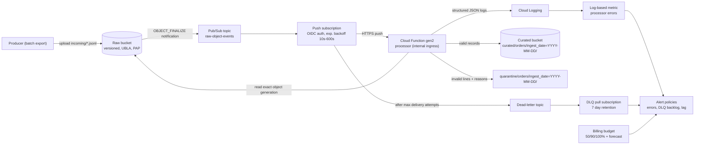

# gcp-event-pipeline

An event-driven ingestion pipeline on Google Cloud, written in Terraform and Python. When a producer drops a JSONL file of order events into a raw bucket, a Cloud Function (2nd gen) picks it up. The function validates every line with Pydantic and writes normalized records to a date-partitioned curated zone. Bad lines go to a quarantine prefix. Retries, dead-lettering, alerting and a cost budget are all part of the infrastructure code.

> **Status:** validated, not deployed. Every module passes `terraform validate`, `tflint`, `checkov` and `terraform test`. The tests run against a mocked Google provider, so they need no credentials and make no cloud calls. The Python processor is covered by unit and HTTP-level tests. The author has **not** run `terraform apply` against a real project. The [deploy section](#deploy) shows how someone with a GCP project would do it.

## What it shows

- **Messaging with at-least-once delivery handled correctly.** Outputs are named from the source object's name and generation, and they are created with a create-only precondition (`ifGenerationMatch=0`). A redelivered event therefore can't duplicate or overwrite data.
- **Failure classification.** Transient errors return 5xx, so Pub/Sub retries them with exponential backoff and dead-letters them after N attempts. Bad data is quarantined with the reason attached. Events that can never be processed are logged at ERROR and acknowledged, so they don't use up retries.
- **Least-privilege IAM.** There are three dedicated service accounts. The runtime identity has no project-level roles: it can read the raw bucket and create objects in the curated bucket, and nothing else.
- **Streaming.** Input is read in 8 MiB ranged chunks and output is uploaded in resumable chunks. Memory use stays flat whatever the file size.
- **Tested infrastructure.** `terraform test` with `mock_provider` checks hardening (versioning, public access prevention), DLQ attempts, retry policy, IAM roles, variable validation and both delivery modes.

## Architecture



The diagram shows the default `pubsub_push` delivery mode. `delivery_mode = "eventarc"` swaps the push subscription for an Eventarc Pub/Sub trigger on the same topic; see [trade-offs](#trade-offs).

## Event flow

1. **Upload.** A producer writes `gs://<raw>/incoming/<anything>.jsonl` (or `.ndjson`).
2. **Notify.** Cloud Storage publishes an `OBJECT_FINALIZE` notification (`JSON_API_V1` payload) to the topic. Only objects under the `incoming/` prefix trigger it.
3. **Deliver.** The push subscription POSTs the message to the function's URL. The request carries an OIDC token minted for the invoker service account. The function's ingress is `ALLOW_INTERNAL_ONLY`, and Pub/Sub push counts as internal traffic. `functions-framework` turns the push body into a `google.cloud.pubsub.topic.v1.messagePublished` CloudEvent. That is the same shape Eventarc delivers, so the handler code is identical in both modes.
4. **Process** (`processor/pipeline/processor.py`):
   - The handler reads the exact **generation** named in the event. If the file was overwritten later, it doesn't get processed twice under the wrong event.
   - Each line goes through: decode UTF-8, parse JSON, validate against `OrderEvent` (Pydantic v2, `extra="forbid"`), then normalize. Normalization uppercases the currency, converts timestamps to UTC, derives `event_date`, recomputes and checks the total with half-up rounding, and adds `_source` lineage (`bucket`, `object`, `generation`, `line`).
   - Valid records stream to `curated/orders/ingest_date=<object creation date, UTC>/<name>-g<generation>.jsonl`.
   - Invalid lines stream to the same path under `quarantine/orders/…`. Each one carries `line`, `reason` (`invalid_json`, `invalid_utf8`, `not_an_object`, `schema_validation`, `line_too_large`) and per-field errors.
   - The partition is the **ingestion** date (object creation time). It never changes across redeliveries, which keeps outputs deterministic. `event_date` is still on every record for downstream partitioning.
5. **Ack or retry:**

   | Situation | Handler result | What happens next |
   |---|---|---|
   | File processed (any mix of valid/invalid lines) | 2xx | acked |
   | Output already exists (redelivery) | 2xx, logs `duplicate_output` | acked, existing data untouched |
   | Object or generation deleted before processing | 2xx, WARNING | acked |
   | Unsupported prefix/extension, non-finalize event | 2xx, INFO | acked |
   | Unparseable event or wrong event type | 2xx, ERROR | acked; error metric fires the alert |
   | Storage/network error, crash, timeout | 5xx | redelivered with exponential backoff (10s → 600s) |
   | Still failing after `max_delivery_attempts` (default 5) | — | forwarded to the DLQ; the DLQ backlog alert fires |

### Idempotency in detail

At-least-once delivery means the same notification can arrive twice, sometimes concurrently. Each output is written with a resumable upload that carries `ifGenerationMatch=0`, so Cloud Storage only creates the object if no live object exists at that name. The object becomes visible only when the upload is finalized. As a result:

- A duplicate delivery gets `412 Precondition Failed` and is recorded as `already_exists`. The first writer's data is never touched.
- A crash mid-file cancels or abandons the upload, and nothing becomes visible. The retry starts cleanly.
- The curated and quarantine outputs commit independently. If the curated file was committed but the quarantine one wasn't, a retry fills in only the missing one. A test covers this case.
- The runtime service account only needs `storage.objects.create`. It never needs read, overwrite or delete on curated data.

Output is byte-for-byte deterministic (sorted keys, no wall-clock fields), so it doesn't matter which delivery wins.

### Replaying dead letters

```bash
gcloud pubsub subscriptions pull evp-dev-raw-object-events-dlq-sub --limit=10 --format=json
# Fix the root cause, then re-publish the original message (data + attributes) to the
# notification topic. Replays are safe because processing is idempotent.
```

You can also re-trigger a file by uploading it again. That creates a new generation, which produces a new, separately named output.

## IAM

| Identity | Role | Scope | Why |
|---|---|---|---|
| `<prefix>-fn-run` (runtime) | `roles/storage.objectViewer` | raw bucket | read the uploaded file |
| `<prefix>-fn-run` (runtime) | `roles/storage.objectCreator` | curated bucket | create outputs; can't overwrite or delete |
| `<prefix>-fn-invoke` (invoker) | `roles/run.invoker` | the processor's Cloud Run service | identity on push / Eventarc requests |
| `<prefix>-fn-invoke` | `roles/eventarc.eventReceiver` | project (eventarc mode only) | required by Eventarc triggers |
| `<prefix>-fn-build` (build) | `roles/logging.logWriter`, `roles/artifactregistry.writer` | project | Cloud Build logs and image push |
| `<prefix>-fn-build` | `roles/storage.objectViewer` | function source bucket | read the source zip |
| Cloud Storage service agent | `roles/pubsub.publisher` | notification topic | publish bucket notifications |
| Cloud Storage service agent | `roles/cloudkms.cryptoKeyEncrypterDecrypter` | CMEK key (if set) | encrypt bucket objects |
| Pub/Sub service agent | `roles/iam.serviceAccountTokenCreator` | invoker SA | mint OIDC tokens for push |
| Pub/Sub service agent | `roles/pubsub.publisher` | dead-letter topic | forward dead letters |
| Pub/Sub service agent | `roles/pubsub.subscriber` | processing subscription | ack forwarded messages |

The runtime identity has no project-level roles. It doesn't need logging permissions either, because Cloud Run captures stdout. Whoever runs `terraform apply` also needs `roles/iam.serviceAccountUser` on the runtime and build service accounts.

## Repository layout

```
processor/                 Python 3.12 Cloud Function
  main.py                  functions-framework entry point (process_raw_object)
  pipeline/                events.py, models.py, processor.py, storage.py, gcs.py, handler.py
  tests/                   pytest suite + in-memory ObjectStore fake
terraform/
  modules/storage          raw + curated buckets
  modules/messaging        notification, topic, push subscription, DLQ
  modules/processor        function, source packaging, service accounts, IAM
  modules/observability    log metric, alert policies, budget
  modules/*/tests          terraform test suites (mock provider)
  envs/dev                 environment root (variables with validation, tfvars example, backend example)
examples/                  sample input file (valid and invalid lines)
.github/workflows/ci.yml   ruff, pytest, terraform fmt/validate/test, tflint, checkov
```

## Deploy

Prerequisites: a GCP project with billing enabled, Terraform ≥ 1.7, and `gcloud auth application-default login` as a user who can create service accounts, IAM bindings, buckets, Pub/Sub, Cloud Functions and monitoring resources. A billing-account permission is needed only if you enable the budget.

```bash
cd terraform/envs/dev
cp terraform.tfvars.example terraform.tfvars      # set project_id, alert_emails, optionally billing_account / kms_key_name
# optional: configure remote state in backend.tf
terraform init
terraform plan -out tfplan
terraform apply tfplan
```

Smoke test after apply:

```bash
RAW=$(terraform output -raw raw_bucket); CURATED=$(terraform output -raw curated_bucket)
gcloud storage cp ../../../examples/orders-2026-10-26.jsonl "gs://$RAW/incoming/"
sleep 30
gcloud storage ls -r "gs://$CURATED/"
# expect curated/orders/ingest_date=.../orders-2026-10-26-g<gen>.jsonl  (2 records)
# and    quarantine/orders/ingest_date=.../orders-2026-10-26-g<gen>.jsonl (3 records)
gcloud logging read 'jsonPayload.event="file_processed"' --limit=5 --format=json
```

Things to expect on a first apply in a brand-new project:

- Service APIs are enabled by this configuration. Their propagation can take a few minutes, and the first apply occasionally needs re-running.
- The Pub/Sub and Cloud Storage service agents are created lazily by Google. If a binding fails because an agent doesn't exist yet, `gcloud beta services identity create --service=pubsub.googleapis.com` creates it.
- `google_billing_budget` uses `user_project_override`, so the Billing Budgets API is called against this project's quota.

## Testing

```bash
make venv          # creates .venv and installs processor/requirements-dev.txt
make check         # ruff, pytest, terraform fmt + validate + test, tflint, checkov
```

| Suite | Count | What it covers |
|---|---|---|
| `processor/tests` (pytest) | 52 tests | schema validation and normalization, valid/invalid split, quarantine reasons, partition paths, idempotent redelivery, partial-commit recovery, new generations, malformed files (binary, truncated JSON, JSON array), oversized lines, empty files, prefix/extension filtering, missing sources, transient errors, a streaming proof on a 60k-line file, the GCS adapter contract (mocked client), and end-to-end HTTP through `functions-framework` for both Pub/Sub push and Eventarc binary CloudEvents |
| `terraform test` (5 suites) | 23 runs | bucket hardening and lifecycle, CMEK wiring, notification filter, retry/DLQ settings and service-agent grants, least-privilege IAM, ingress, Eventarc mode, alert filters, budget thresholds, root variable validation, full-stack plan in both modes |
| static analysis | — | `terraform fmt`, `validate`, `tflint` (terraform preset `all` + google ruleset), `checkov` (Terraform + GitHub Actions), `ruff` |

`terraform test` runs in plan mode against `mock_provider "google"`. The provider's own schema validation still applies (for example, service account ID formats), but nothing is created. The archive provider runs for real: it zips `processor/` reproducibly and excludes tests.

Checkov skips are written inline next to the resource with a reason. There are three, all `CKV_GCP_62` (legacy bucket usage logs) on the raw, curated and source buckets; access to those buckets is audited through Cloud Audit Logs instead.

## Cost notes

These are rough figures for a dev-sized workload, assuming `min_instances = 0`. Check the current GCP pricing pages before relying on them.

- **Idle:** close to zero. You pay for storage only: raw and curated data, versioned copies kept for 30 days, the function source zips, and the container image in Artifact Registry (one image of a few hundred MB). Setting `min_instances > 0` keeps an instance billed around the clock and is the most common way to get a surprise bill.
- **Per file:** one Cloud Function invocation (billed vCPU-seconds + GiB-seconds), plus a few Pub/Sub messages and Cloud Storage class A/B operations. Thousands of files a day typically fit within the free tiers of Functions/Run and Pub/Sub.
- **Watch:** Cloud Build minutes on every code change. Cloud Logging ingestion above the free allotment (each file logs one INFO line, plus errors). Monitoring alert conditions, which Google has announced it will charge for per condition. NEARLINE retrieval fees if you replay files older than 30 days.
- **Guardrail:** the optional billing budget notifies at 50/90/100% of actual spend and at 100% of forecast. It only alerts. It does **not** cap spend; capping needs a budget → Pub/Sub → function that disables billing, which is deliberately out of scope.

## Trade-offs

- **Push subscription by default instead of an Eventarc trigger.** An Eventarc Pub/Sub trigger creates its own Pub/Sub subscription. You can't declare that subscription's dead-letter policy and retry window from Terraform, and failed events are dropped once Eventarc's retry window expires. Owning the subscription gives explicit exponential backoff, a DLQ with a 7-day retention, and a DLQ backlog alert. `delivery_mode = "eventarc"` is supported and tested for teams that prefer the managed trigger. The handler accepts both shapes, plus direct `google.cloud.storage.object.v1.finalized` events.
- **Create-only writes instead of an existence check.** The runtime SA can't read curated data, so a duplicate delivery re-reads and re-validates the input before Cloud Storage rejects the write. Duplicates are rare, so this extra work is a reasonable cost for the tighter permissions. Granting `objectViewer` on the curated bucket would allow a cheap upfront check.
- **One output per input file.** This keeps lineage and idempotency simple. Many tiny files lead to many tiny outputs, so compaction belongs downstream (BigQuery load or a periodic merge job).
- **Duplicate `event_id`s inside or across files are not removed.** Removing them needs state: an in-memory set breaks streaming for huge files. Records carry `event_id` and `_source` so the warehouse can deduplicate.
- **Invalid events are acked, not dead-lettered.** Retrying a malformed notification can't succeed. It is logged at ERROR and counted by the error metric. The DLQ holds only events that failed for operational reasons and are worth replaying.
- **Concurrency of 1 per instance.** This keeps memory predictable (one reader plus two 8 MiB upload buffers). Throughput scales with instances, capped by `max_instances`.

## Roadmap

- BigQuery external table or scheduled load over `curated/orders/ingest_date=*` (hive partitioning).
- Workload Identity Federation and a `plan` job on pull requests once the project has a sandbox environment.
- Schema versioning (`schema_version` field, with model selection per version) and a contract test against producer fixtures.
- A gzip-compressed input option (`.jsonl.gz`) through streaming decompression.
- An `apply`-based integration test in an ephemeral project, with Pub/Sub and GCS emulators for local end-to-end runs.
- CMEK for the Pub/Sub topics. The variable already exists in the messaging module; it still needs the Pub/Sub agent key grant wired up.

## License

[MIT](LICENSE)
